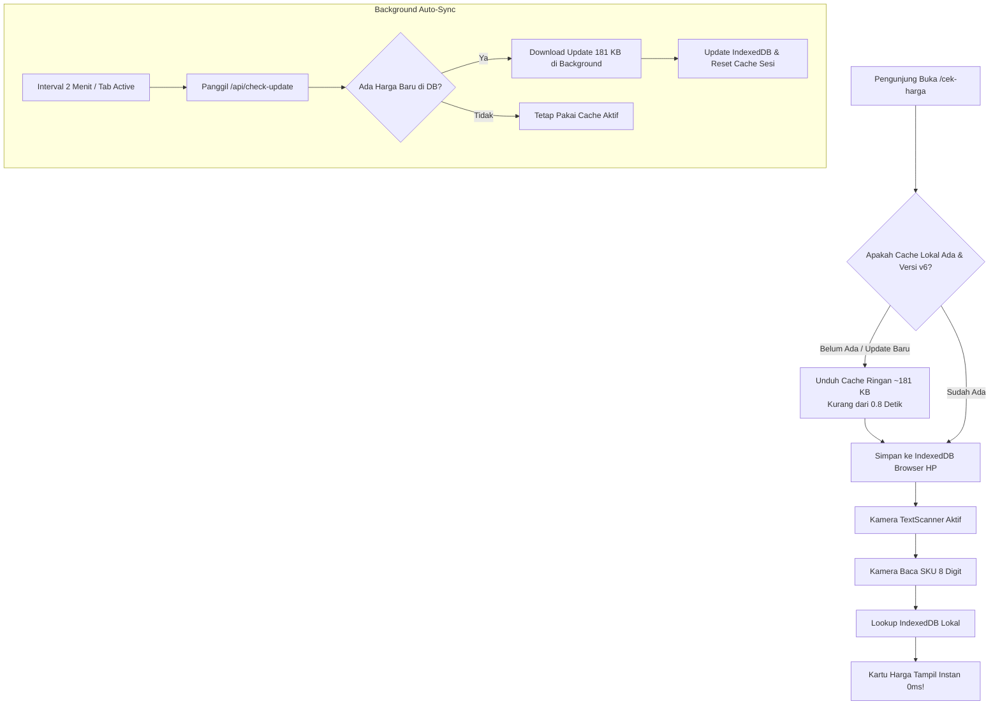

# Walkthrough: Optimalisasi Kiosk Cek Harga Publik (Offline-First Cache 0ms)

## 📌 Ringkasan Masalah & Kebutuhan

1. **Loading Scan Terlalu Lama**:
   Sebelumnya, setiap kali pengunjung memindai SKU, sistem melakukan dua kali request beruntun ke server lewat internet. Pada koneksi seluler pengunjung, hal ini menimbulkan jeda loading *"Memeriksa Harga..."* yang lambat dan mengganggu.
2. **Kode Artikel Tertempel di Ujung Nama Produk**:
   Di database ritel, teks deskripsi sering kali memuat kode artikel di ujung kalimat (contoh: `T-SHIRT QUICK DRY CBS01` atau `CONTAINER FOOD FDCNT` atau `TOWEL SKBTWHT`). Kode ini membingungkan pelanggan jika muncul di nama besar produk.
3. **Promo BOGO, Diskon 60%, BXGY Tidak Tampil di Kiosk**:
   Kiosk sebelumnya hanya memeriksa `hargaPromo > 0`. Pada promo seperti `BELI 1 DISKON 60%`, `BELI 2 GRATIS 1`, `BELI 1 GRATIS 1`, dan `B1D60`, harga satuan promo tidak memiliki flat price (masih bernilai 0 atau sama dengan harga normal), sehingga sebelumnya sistem keliru menganggap produk tidak sedang promo.
4. **Elemen Staff Login di Halaman Publik**:
   Header atas dan footer masih memuat tautan *"Staff Login"*, yang tidak relevan dan membingungkan pelanggan toko.
5. **Kebutuhan Data Selalu Terkini**:
   Jika admin toko memperbarui harga atau promo di database, cache di HP pengunjung harus otomatis mengikuti tanpa perlu campur tangan manual.

---

## ⚡ Solusi & Arsitektur yang Diterapkan

---

## 🏷️ Perbaikan UI/UX Promo: BOGO, BXGY & Diskon 60%

| Tipe Promo | Tampilan Header Kartu | Tampilan Area Harga |
|---|---|---|
| **Flat Special Price** (misal Rp 99.000) | `🏷️ HARGA SPESIAL 99000` • `HEMAT Rp 30.900` | Coret harga normal (`~~Rp 129.900~~`), angka promo merah besar (`Rp 99.000`), badge `23% OFF` |
| **BOGO / BXGY** (misal: Beli 2 Gratis 1) | `🎁 BELI 2 GRATIS 1` • `PROMO AKTIF` | Harga normal satuan (`Rp 89.900`) + Kartu Ungu: *"Promo otomatis terhitung di kasir saat pembayaran"* |
| **Diskon Bertingkat** (misal: Beli 1 Diskon 60%) | `% BELI 1 DISKON 60%` • `PROMO AKTIF` | Harga normal satuan (`Rp 49.900`) + Kartu Ungu Diskon: *"Beli 1 barang, barang ke-2 diskon 60% di kasir"* |

---

## 🧹 Pembersihan Kode Artikel dari Judul

* **Judul Utama (`H1`)**: Murni nama produk (contoh: `T-SHIRT QUICK DRY KERAH BULAT LENGAN PENDEK`). Kode artikel seperti `CBS01` atau `SKBRPRP` otomatis dideteksi dan dibersihkan dari teks judul.
* **Badge Bawah**: Kode artikel ditampilkan rapi di samping SKU:
  $$\boxed{\text{Ukuran: 160}} \quad \boxed{\text{Warna: SAND}} \quad \boxed{\text{Artikel: CBS01}} \quad \boxed{\text{SKU: 61356601}}$$

---

## 🛠️ Rincian Perubahan File

1. [`src/app/cek-harga/page.tsx`](file:///c:/Max%20Display/price-checker/src/app/cek-harga/page.tsx):
   * Pembersihan kode artikel dari deskripsi (`parseProductInfo`).
   * Deteksi promo lengkap: `isBogoPromo`, `isPercentPromo`, `hasSpecialDiscountType`.
   * UI/UX kartu promo khusus untuk BOGO / BXGY / Diskon 60%.
   * Skema cache auto-update ke `v6`.
2. [`src/app/api/export-products/route.ts`](file:///c:/Max%20Display/price-checker/src/app/api/export-products/route.ts):
   * Menyertakan kolom `acara`, `discountType`, `diskon`, `article`, `barcode`.
3. [`src/lib/offlineDb.ts`](file:///c:/Max%20Display/price-checker/src/lib/offlineDb.ts):
   * Menaikkan skema Dexie ke `version(6)` dengan indexing lengkap dan migrasi otomatis.
