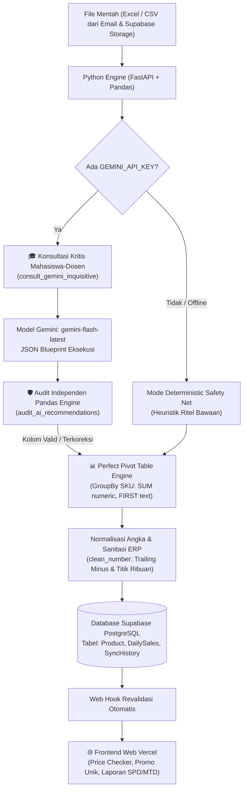

# Walkthrough: Migrasi & Upgrade Python Data Engine dengan Google Gemini AI & Smart Search

Dokumen ini mendokumentasikan secara lengkap arsitektur, kode, alur kerja, dan panduan konfigurasi setelah keberhasilan migrasi **Python Retail Data Engine** (`python-engine/`) dan pembaruan **Mesin Pencarian Cerdas** di frontend Vercel Next.js.

---

## 1. Ringkasan & Tujuan Utama

Sistem Price Checker dan Laporan Penjualan ritel ditingkatkan untuk mengatasi tantangan pemrosesan data Power Query (PQ) dan Promo mingguan berukuran puluhan ribu baris:
1. **Integrasi Asisten AI Kritis (Google Gemini AI)**: Menggunakan paradigma *"Mahasiswa Kritis & Dosen Ahli"*, engine mengajukan pertanyaan spesifik terkait kebutuhan tampilan web Vercel (Pencarian Produk, Promo Unik, Barang Baru, Laporan Omzet SPD/MTD, dan Rekap Stok).
2. **Sistem Audit Independen (Self-Auditing Parser)**: Pandas Engine memverifikasi setiap jawaban AI sebelum dieksekusi. Jika AI salah menyebut kolom atau berhalusinasi, audit otomatis melakukan koreksi (*fuzzy fallback*) dan memotong skor kesiapan (*Readiness Score*).
3. **Perfect Pivot Table Engine**: Mengonsolidasi data CSV mentah (50.000+ baris) menjadi 1 baris unik per SKU dengan agregasi vektor (`df.groupby().agg()`) dalam waktu < 0,5 detik.
4. **Sanitasi Format ERP Ritel Indonesia**: Menangani trailing minus (contoh `7 -` $\rightarrow$ `-7`), pemisah ribuan rupiah titik (contoh `1.270.400` $\rightarrow$ `1270400`), dan sel strip (` - ` $\rightarrow$ `0`).
5. **Smart Article-First Search (Vercel Frontend)**: Pencarian cerdas berbasis nama artikel, toleran terhadap variasi spasi (`na young` vs `nayoung`, `cbs 01` vs `cbs01`), multi-kata (artikel + warna), serta memblokir data dummy (*Anti-Dummy Shield*).

---

## 2. Arsitektur Alur Data (Data Flow Architecture)



---

## 3. Komponen & Berkas yang Ditingkatkan

### A. Python Engine (`python-engine/`)

| Berkas | Peran & Perubahan |
| :--- | :--- |
| [`requirements.txt`](file:///c:/Max%20Display/price-checker/python-engine/requirements.txt) | Pinned dependency modern: `fastapi>=0.110.0`, `pandas>=2.2.0`, `openpyxl>=3.1.2`, `google-genai>=0.1.1`, `httpx>=0.27.0`. |
| [`Dockerfile`](file:///c:/Max%20Display/price-checker/python-engine/Dockerfile) | Container multi-stage Python 3.11 untuk deployment Railway/Docker dengan dynamic port `$PORT`. |
| [`runtime.txt`](file:///c:/Max%20Display/price-checker/python-engine/runtime.txt) | Menetapkan spesifikasi versi `python-3.11.9`. |
| [`ai_helper.py`](file:///c:/Max%20Display/price-checker/python-engine/ai_helper.py) | **Mesin Konsultasi & Audit AI**: <br/>1. `call_gemini()`: REST API direct call dengan `response_mime_type: application/json`.<br/>2. `consult_gemini_inquisitive()`: Formulasi 6 pertanyaan kritis berorientasi web Vercel.<br/>3. `audit_ai_recommendations()`: Verifikasi kolom, fuzzy keyword fallback, scoring 0-100%, dan audit log transparan. |
| [`parser.py`](file:///c:/Max%20Display/price-checker/python-engine/parser.py) | **Engine Parser Ritel**: <br/>1. Sanitasi `clean_number()` format ritel Indonesia.<br/>2. Integrasi konsultasi & audit AI di `parse_promo_file()` dan `parse_pq_file()`.<br/>3. Vectorized Pivot Engine (`df.groupby().agg()`) berkecepatan tinggi. |
| [`main.py`](file:///c:/Max%20Display/price-checker/python-engine/main.py) | Endpoint sinkronisasi data, perekaman status audit ke `SyncHistory`, dan trigger revalidasi Next.js. |

### B. Next.js Vercel Frontend (`src/`)

| Berkas | Peran & Perubahan |
| :--- | :--- |
| [`src/app/api/product/[identifier]/route.ts`](file:///c:/Max%20Display/price-checker/src/app/api/product/[identifier]/route.ts) | **Mesin Pencarian Cerdas Baru**: <br/>1. *Article-First Search*: Pencarian mencakup 8 atribut (Article, Description, Brand, Dept, Color, Size, SKU, Barcode).<br/>2. *Spaceless & Hyphen Matching*: Toleran spasi (`na young` $\leftrightarrow$ `nayoung`, `cbs 01` $\leftrightarrow$ `cbs01`).<br/>3. *Multi-Keyword Intersection*: Mendukung pencarian gabungan (misal `flannel navy`).<br/>4. *Anti-Dummy Shield*: Memblokir data dummy (`SKU DUMMY` Rp 2) otomatis.<br/>5. *Relevance & Stock Ranking*: Peringkat tertinggi untuk kecocokan artikel persis dan stok aktif toko. |
| [`src/app/api/export-products/route.ts`](file:///c:/Max%20Display/price-checker/src/app/api/export-products/route.ts) | Menambahkan kolom `article` dan `brand` untuk database offline (Dexie DB). |

---

## 4. Mekanisme Audit Otomatis (Saat AI Melakukan Kesalahan)

Jika Gemini AI memberikan jawaban yang salah atau file CSV memiliki format yang rusak, parser menjalankan 4 lapis mitigasi otomatis tanpa crash:

1. **Halusinasi Nama Kolom**:
   * *Masalah*: AI merekomendasikan kolom `TOTAL_SALES_RP` yang tidak ada di CSV.
   * *Audit*: Mengibarkan bendera `❌ [AUDIT REJECT]` dan mengaktifkan kamus `KEYWORD_MAPPING`.
   * *Koreksi*: Dialihkan otomatis ke kolom riil `DAY SALES RETAIL`.
2. **Kolom SKU Rusak / Sampah Metadata**:
   * *Masalah*: AI memilih kolom yang memuat baris `Grand Total`, `Values`, atau `DATA_AS_OF`.
   * *Audit*: Memotong skor kesiapan (`readiness_score -= 30`) dan memindai 20 baris pertama untuk mencari baris header sesungguhnya.
   * *Koreksi*: Pivot engine memfilter baris sampah dengan mask regex.
3. **Format Ritel ERP Aneh**:
   * *Nilai `7 -`*: Diubah menjadi `-7`.
   * *Nilai `1.270.400`*: Diubah menjadi `1270400`.
   * *Nilai ` - `*: Diubah menjadi `0`.
4. **API AI Offline / Kuota Habis**:
   * Parser tidak membatalkan proses sinkronisasi, melainkan otomatis beralih ke mode heuristik deterministik (*Zero Downtime*).

---

## 5. Konfigurasi Variabel Lingkungan (Environment Variables)

### A. Railway Dashboard (Python Engine)
Pastikan variabel berikut terpasang di menu **Variables** Railway:

```env
GEMINI_API_KEY=AQ.Ab8RN6...[DISIMPAN_DI_RAILWAY_VARIABLES]
GEMINI_PROJECT_ID=366513320292
NEXT_PUBLIC_SUPABASE_URL=https://[YOUR_SUPABASE_PROJECT].supabase.co
SUPABASE_SERVICE_ROLE_KEY=[YOUR_SERVICE_ROLE_KEY]
WEBHOOK_SECRET=B4mb4ng123!Aman
VERCEL_URL=https://[YOUR_PROJECT].vercel.app
```

### B. Vercel Dashboard (Next.js)
Pastikan variabel berikut terpasang di menu **Environment Variables** Vercel:

```env
DATABASE_URL=postgresql://...
DIRECT_URL=postgresql://...
NEXT_PUBLIC_SUPABASE_URL=https://[YOUR_SUPABASE_PROJECT].supabase.co
NEXT_PUBLIC_SUPABASE_ANON_KEY=[YOUR_ANON_KEY]
PYTHON_ENGINE_URL=https://[YOUR_RAILWAY_URL].up.railway.app
```

---

## 6. Riwayat Git & Verifikasi Deployment

* **Git Commit**: `a44c510`
* **Pesan Commit**: `feat: upgrade python engine with gemini ai audit & add smart article-first search`
* **Cabang**: `main` $\rightarrow$ `origin/main` ([GitHub Repository](https://github.com/luqmanmenmen/CheckPrice))
* **Build Next.js**: Berhasil 100% tanpa error TypeScript (54 rute terkompilasi).
* **Auto-Deploy**: Terpicu otomatis di Vercel dan Railway.
